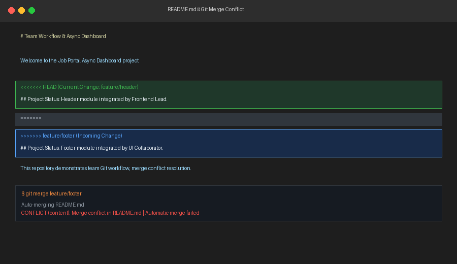

# Team Workflow & Async Dashboard

A comprehensive hands-on project demonstrating professional Git collaboration workflows, merge conflict resolution, essential Git rescue techniques, and resilient asynchronous JavaScript execution patterns (Promises, microtasks, `AbortController`, and fetch error handling).

---

## 1. Git Rescue Moves & Core Concepts

### Why `git reset` is dangerous on shared branches
`git reset` rewrites history by forcefully moving branch pointers backward. If commits have already been pushed to a remote repository and shared with teammates, resetting will cause your local history to diverge from remote history. Pushing this change requires `--force`, which obliterates teammates' work, invalidates their local bases, and causes merge chaos upon their next pull. For shared branches, always use `git revert` instead.

### Git Merge vs. Git Rebase (in 3 lines)
1. **`git merge`** joins divergent branches by creating a new merge commit with two parents, preserving the exact non-linear timeline of when branches existed.
2. **`git rebase`** rewrites history by lifting and replaying your feature commits sequentially on top of the target branch tip, creating a clean linear log.
3. Use **rebase** locally to clean up feature branches before merging; use **merge** to integrate code into protected branches (`main`) without altering shared history.

### Summary of Rescue Commands Demonstrated
- **`git stash` / `git stash pop`:** Temporarily shelters uncommitted working tree modifications so you can switch contexts or check out emergency hotfix branches, then cleanly reapplies them afterward.
- **`git revert <commit-hash>`:** Safely inverts an erroneous commit that was already pushed to remote by generating a brand new commit with opposite diffs, preserving commit audit trails.
- **`git reset --soft HEAD~1`:** Rewinds the current branch pointer by one commit while leaving all file modifications staged in the index, allowing commit messages or staging choices to be revised without losing code.

---

## 2. Team Git Workflow & Merge Conflict Resolution

### Workflow Architecture
- **Collaborative Branching:** Separate feature branches (`feature/header` and `feature/footer`) were branched off `main`.
- **Pull Request Reviews:** `feature/header` added `components/header.js`, and `feature/footer` added `components/footer.js`.
- **Deliberate Merge Conflict:** Both branches updated line 5 of `README.md` with conflicting status declarations.
- **Merge Order:** `feature/header` was merged into `main` first. Attempting to merge `feature/footer` into `main` triggered a standard Git content merge conflict:

```markdown
<<<<<<< HEAD
## Project Status: Header module integrated by Frontend Lead (feature/header).
=======
## Project Status: Footer module integrated by UI Collaborator (feature/footer).
>>>>>>> feature/footer
```

### Conflict Markers Visual Evidence


### Conflict Resolution Strategy
The conflict was manually resolved by combining the contributions from both collaborators:
```markdown
## Project Status: Header and Footer modules successfully integrated and reviewed.
```
The resolution was staged with `git add README.md` and committed with a descriptive merge commit:
`Merge branch 'feature/footer' and resolve README merge conflict`.

---

## 3. Async Dashboard (`async.js`)

Simulates a modern job-portal dashboard fetching data from three microservices with artificial network delays:
1. `getProfile()`: Resolves `{ name: 'Asha' }` after 300 ms.
2. `getJobs()`: Resolves `['Frontend Engineer', 'Full Stack Developer', 'Cloud Architect']` (3 titles) after 500 ms.
3. `getSalaryData()`: Rejects with `'Salary service down'` after 200 ms.
4. `timeout(ms)`: Utility rejecting with `'Timed out after N ms'`.

### Execution Modes & Expected Output
```text
Sequential: Asha with 3 jobs in ~800 ms
Parallel: Asha with 3 jobs in ~500 ms
Promise.all failed: Salary service down
allSettled: fulfilled, fulfilled, rejected
race: Timed out after 400 ms
race: Asha arrived first
```

### Key Technical Insights
- **Sequential vs. Parallel:** Sequential loading costs $300\text{ ms} + 500\text{ ms} \approx 800\text{ ms}$. Parallel execution with `Promise.all` executes concurrently, finishing in $\max(300, 500) \approx 500\text{ ms}$ (a 37.5% latency reduction).
- **All-or-Nothing vs. Fault Tolerance:** `Promise.all` fails fast as soon as `getSalaryData` rejects at 200ms. In contrast, `Promise.allSettled` waits for all three promises, enabling graceful degradation where the UI displays Asha's profile and jobs while displaying an error banner only for salary data.
- **Timeouts with `Promise.race`:** Racing a 400ms timeout against `getJobs` (500ms) triggers the timeout rejection. Racing the same 400ms timeout against `getProfile` (300ms) allows Asha's data to arrive first.

To run:
```bash
node async.js
```

---

## 4. Resilient `fetch` with Error Handling (`safeFetch.js`)

A bulletproof HTTP wrapper function `safeFetch(url, options)` that:
- Uses the native modern `fetch` API.
- Checks `res.ok` (crucial because `fetch()` does **not** reject on HTTP 404 or 500 errors).
- Integrates `AbortController` to automatically cancel requests taking longer than 5 seconds.
- Guarantees return of `{ data, error }` instead of throwing unhandled promise rejections.

### Verified Test Cases
1. **Working Endpoint:** `https://jsonplaceholder.typicode.com/todos/1`
   - Outcome: `{ data: { userId: 1, id: 1, title: '...', completed: false }, error: null }`
2. **404 Endpoint:** `https://jsonplaceholder.typicode.com/posts/99999999/not-found`
   - Outcome: `{ data: null, error: 'HTTP Error 404 (Not Found)' }`
3. **Invalid Domain / Network Failure:** `https://this-domain-definitely-does-not-exist-xyz123.com`
   - Outcome: `{ data: null, error: 'fetch failed' }`

To run tests:
```bash
node safeFetch.js
```

---

## 5. Interview Questions & Answers

See [INTERVIEW.md](./INTERVIEW.md) for concise (< 80 words) technical interview answers covering:
1. Microtasks vs. Macrotasks and event loop execution order.
2. `Promise.allSettled` vs. `Promise.all` architectural trade-offs.
3. Differences between `git merge` vs. `git rebase` and `git reset` vs. `git revert`.

---

## Project Structure

```text
team-workflow-async-dashboard/
├── .gitignore
├── package.json
├── README.md                 # Complete guide, rescue moves, conflict analysis
├── INTERVIEW.md              # Interview corner questions & answers (<80 words)
├── async.js                  # Job portal microservices & Promise drills
├── safeFetch.js              # Resilient fetch utility with AbortController
├── components/
│   ├── header.js             # Component created on feature/header
│   └── footer.js             # Component created on feature/footer
└── screenshots/
    └── conflict-markers.png  # High-fidelity visual of merge conflict markers
```
